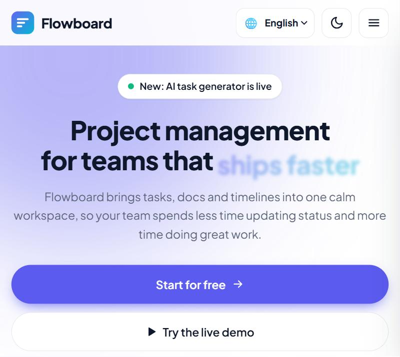
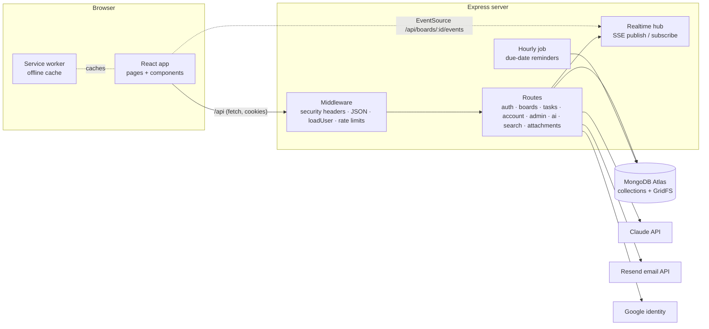

# Flowboard

**A real-time Kanban project manager for small teams**: boards, sharing, live updates, AI task planning, notifications and an admin dashboard. Built with React, Express and MongoDB.

<p align="center">
  
</p>

> 📸 More screenshots: add desktop shots of the board, task popup and admin page to `docs/screenshots/` and link them here.

---

## ✨ Features

**Boards & tasks**
- Multiple boards with custom columns, drag & drop (mouse **and** touch), **calendar and timeline (Gantt) views**, board themes
- Tasks with priority, due dates, labels, checklists, comments, file attachments and **repeat** (daily / weekly / monthly)
- Undo delete, keyboard shortcuts, **Ctrl + K** command palette that searches every board
- **Activity history** per task and per board ("Anu moved Logo → Done · 2 min ago")

**Teamwork**
- Share a board by email; members can edit, only the owner can change settings
- **Real-time sync**: changes from teammates appear instantly (Server-Sent Events)
- Assign tasks, **@mentions** in comments (works with Tamil, Sinhala and Hindi names), notifications for assignments, mentions, comments, shares and due-date reminders, optional desktop alerts

**Smart**
- **AI task generator** (Claude): describe a goal, get a task list
- **Plan my day**: picks your 3 most important tasks with a reason
- Both work in a free demo mode without an API key

**Accounts**
- Email + password (scrypt hashing), **Sign in with Google**, forgot / reset password by email
- Profile, avatar colour, personal stats (streak, done this week, overdue), delete account

**Website**
- Whole site **including the board** in **English, தமிழ், සිංහල, हिन्दी**, real user reviews (admin approved), "What's new" updates, site banner
- Installable **PWA** with offline support, dark mode, confetti 🎉

**Admin**
- Dashboard with charts, contact messages (reply + CSV export), users (disable), reviews, updates, banner and an **audit log**

---

## 🧱 Tech stack

| Layer | Tech |
|---|---|
| Frontend | React 18, React Router 6, Vite, plain CSS (custom properties, dark mode) |
| Backend | Node.js 24, Express 5 (ES modules) |
| Database | MongoDB Atlas (official driver), GridFS for files, TTL indexes |
| Real-time | Server-Sent Events (no extra library) |
| AI | Anthropic Claude API (structured JSON output) |
| Tests | Node test runner (API), Vitest + Testing Library (components), Playwright (real Chrome) |
| Types | **TypeScript (strict) everywhere**: the server runs .ts directly on Node 24, the website is built by Vite |

No auth, upload, validation or security libraries: those parts are written by hand so every line can be explained.

---

## 🗺️ Architecture



**Request flow example (moving a task):** the browser updates the card instantly (optimistic UI) → `POST /api/tasks/reorder` → the server checks the user can access the board → saves the new order in one `bulkWrite` → records completion for stats / repeats → publishes a `tasks` event → every other open tab on that board refetches.

---

## 📁 Project structure

```
flowboard/            React website (Vite)
  src/components/     Navbar, Demo (the board), TaskModal, CommandPalette, NotificationBell…
  src/pages/          Home, Board, Sign in, Account, Forgot / Reset password
  src/context/        Auth, Toast, Language
  src/hooks/          useTheme, useTouchDrag, useConfig…
  public/             manifest, service worker, icons, robots.txt
server/               Express API
  index.js            start-up: env → database → app → listen
  app.js              createApp(): middleware + routes (used by tests too)
  db.js               MongoDB connection, collections, indexes
  lib/                auth, boards (access rules), realtime, notify, email, google, security…
  routes/             one file per area (auth, boards, tasks, admin…)
  test/               node:test suites (run against a separate test database)
docs/                 screenshots
```

---

## 🚀 Getting started

**Requirements:** Node.js 24+, a free MongoDB Atlas cluster.

```bash
# 1. install
npm install --prefix server
npm install --prefix flowboard

# 2. configure: create server/.env (see below)

# 3. run (two terminals)
npm run dev --prefix server      # API on http://localhost:3001 (auto-restarts)
npm run dev --prefix flowboard   # website on http://localhost:5173
```

Admin dashboard: <http://localhost:3001/admin>

### Environment variables (`server/.env`)

| Variable | Required | What it does |
|---|---|---|
| `MONGODB_URI` | ✅ | MongoDB Atlas connection string |
| `ADMIN_PASSWORD` | ✅ | Password for `/admin` (use a long one) |
| `ANTHROPIC_API_KEY` | optional | Real AI suggestions (otherwise demo templates) |
| `GOOGLE_CLIENT_ID` | optional | Shows "Continue with Google" |
| `RESEND_API_KEY`, `EMAIL_FROM` | optional | Sends real emails (otherwise links are printed in the server terminal) |
| `APP_URL` | optional | Website address used in emails and Stripe return links (default `http://localhost:5173`) |
| `ADMIN_EMAIL` | optional | Website accounts (comma separated) that can also log in to `/admin` with their own email + password |
| `STRIPE_SECRET_KEY`, `STRIPE_PRICE_ID`, `STRIPE_WEBHOOK_SECRET` | optional | Turns on Pro plan payments (otherwise "coming soon") |
| `VAPID_PUBLIC_KEY`, `VAPID_PRIVATE_KEY` | optional | Push notification keys (otherwise generated once and stored in the database) |
| `PORT` | optional | API port (default 3001) |

`.env` is git-ignored. Never commit keys.

---

## 🧪 Tests

```bash
npm test --prefix server            # 140+ API, security and unit tests
npm run typecheck --prefix server   # TypeScript strict check (server)
npm run typecheck --prefix flowboard # TypeScript strict check (website)
npm test --prefix flowboard         # component tests (Vitest)
npm run test:e2e --prefix flowboard # 9 browser tests in real Chrome (Playwright)
```

The suites start the app on a random port against a separate **`flowboard_test`** database (refuses any name that doesn't end in `_test`, and drops it before and after). They cover sign-up/login, access control between users, sharing, real-time events, notifications, repeats, reminders, attachments, password reset, Google sign-in (with a fake verifier), admin actions and security headers.

---

## 🔐 Security

| Threat | Protection |
|---|---|
| Password leaks | scrypt with a per-user salt, timing-safe comparison, hashes never sent to the client |
| Session theft | random tokens in `httpOnly`, `SameSite=Strict` cookies; sessions expire (TTL index) |
| Brute force / spam | per-IP rate limits on login, sign-up, contact, reviews, AI |
| XSS | React escaping, `escapeHtml` on server-rendered admin pages, strict **Content-Security-Policy** with per-request nonce, uploads limited to safe types with `nosniff` |
| Clickjacking | `frame-ancestors 'none'` + `X-Frame-Options: DENY` |
| NoSQL / regex injection | type checks on every input (`isText`), escaped regex for search |
| CSV injection | formula characters prefixed in exports |
| Access control | every board / task / file request checks owner or member; tested with a "stranger" user |
| Account enumeration | same response for unknown emails on login and password reset |
| Reset links | random 256-bit token, stored as a SHA-256 hash, one-time, expires in 1 hour |
| Stolen API key | stored as a hash, can't touch account / auth / key routes, per-key rate limit, instant revoke |
| Webhook SSRF | https only, private IPs blocked at save time and at connect time (DNS rebinding), no redirects, 5 s timeout |

---

## 📜 API docs

With the server running, open <http://localhost:3001/api/docs> for interactive Swagger docs (a unit test fails if any route is missing from them).

### 💬 Team chat

Every board has a live chat (**💬 Chat** on the board bar). Members and viewers can talk; `@Name` sends a notification; new messages arrive over the same Server-Sent Events stream as task changes. You can delete your own messages, and the board owner can delete any. Chat is off on the public demo board.

### 🤖 AI assistant

**🤖 Ask AI** on the board answers questions about your own tasks ("What is overdue?", "What is due this week?"), in the language you write in, and links the tasks it mentions. With `ANTHROPIC_API_KEY` it uses Claude (`claude-opus-5-5`, low effort, server-side refusal fallback); without it, simple keyword rules answer in demo mode. Task titles are sent as data inside `<tasks>` tags and the system prompt tells Claude to ignore instructions in them.

### 🔔 Push notifications

Account → **Phone & desktop alerts** subscribes the browser (Web Push with VAPID via the `web-push` package). Every in-app notification (assigned, mentioned, shared, due soon) is also pushed; clicking it opens the task. Subscription endpoints are limited to the known push services (Google, Mozilla, Microsoft, Apple) so the server can't be pointed at other hosts. Works on the built site over HTTPS or localhost, not the Vite dev server.

### 🎨 Themes and 📱 mobile

Light, dark, midnight (pure black) or system mode, plus six accent colours (Account → Appearance, saved per device). On phones, signed-in users get an app-style bottom tab bar, and iPhone users see how to add Flowboard to the Home Screen.

### 🗂️ Templates, 🏷️ labels, ⏱️ timer, 📊 reports, 📅 calendar

- **Templates:** `GET /api/templates` lists ready-made boards (wedding, exam prep, trip, product launch, moving, weekly planner); `POST /api/boards {template}` creates one with its columns, labels and tasks.
- **Custom labels:** each board has up to 12 labels (`{id, name, color}`, 8 colours) edited in Board settings. Tasks keep only labels that exist on their board, and deleting a label removes it from the tasks.
- **Time tracking:** `POST /api/tasks/:id/timer {action: start|stop|reset}`. One running timer per person (starting another stops the first); a forgotten timer counts at most 12 hours per session.
- **Reports:** `/reports` shows the last 7 or 30 days (completed vs created per day, boards, priorities, most time spent). **Download PDF** uses the browser's print dialog with a print stylesheet.
- **Calendar feed:** Account → Calendar gives a private `.ics` link (Google Calendar → Other calendars → From URL). The token in the link is the only password, so it can be replaced with a new one.
- **Shortcuts:** press **?** on the board for the full list (N, /, B, C, T, A, M, H, P, Esc, Ctrl+K). On phones, long-press a card to drag it; the page scrolls by itself near the edges.

### ⚡ Performance and accessibility

Lighthouse (production build): accessibility 100, best practices 100, SEO 100, performance 97 on desktop and about 85 on the simulated slow-4G phone profile. Fonts load without blocking the first paint, Tamil / Sinhala / Hindi text and fonts download only when that language is chosen, and the live demo board on the home page loads after the hero.

### 📊 Analytics

The website reports page views and a few events (sign up, task created, CTA clicks…) to `POST /api/track`. The admin page shows visitors, page views, top pages, referrers, events and devices for the last 30 days.

- No cookies and no IP addresses are stored. A visitor is `sha256(daily random salt + IP + user agent)`, so the same person can't be followed across days.
- Do Not Track, Global Privacy Control and bots are skipped. Query strings and MongoDB ids are stripped from paths. Data is deleted after 90 days.

### 💳 Payments (Stripe)

Pro unlocks more boards, more people per board and more AI requests per hour (`server/lib/billing.ts` `PLAN_LIMITS`). Card details are only typed on Stripe's own Checkout page.

1. In the Stripe dashboard (test mode), create a product **Pro** with a monthly price and copy its `price_...` id.
2. Add a webhook endpoint `https://<your-site>/api/billing/webhook` for `checkout.session.completed`, `customer.subscription.updated` and `customer.subscription.deleted`, and copy its signing secret.
3. Put `STRIPE_SECRET_KEY`, `STRIPE_PRICE_ID` and `STRIPE_WEBHOOK_SECRET` in `server/.env` and restart.

Webhooks are verified with the `Stripe-Signature` HMAC (5-minute window). Deleting an account cancels its subscription first.

### 🔑 API keys

Create a key under **Account → API keys** and send it as a header:

```bash
curl http://localhost:3001/api/boards -H "Authorization: Bearer fb_your_key"
```

- The key acts as you on boards and tasks. It **can't** log in, change or delete your account, or manage keys and webhooks.
- Only a SHA-256 hash is stored, so the full key is shown once. Revoking a key stops it immediately.
- Each key is limited to 120 requests per minute.

### 🪝 Webhooks

Board owners can add an `https://` URL under **Account → Webhooks**. Slack incoming-webhook and Discord webhook URLs are detected automatically and get short readable messages instead of JSON. Flowboard POSTs JSON for each chosen event: `task.created`, `task.edited`, `task.moved`, `task.completed`, `task.assigned`, `task.commented`, `task.attached` and `task.deleted`.

```json
{ "id": "…", "event": "task.moved", "createdAt": "…", "board": { "id": "…", "name": "My board" },
  "task": { "id": "…", "title": "Logo" }, "actor": { "name": "Anu", "viaApiKey": false }, "detail": "Doing" }
```

To check that a request really came from Flowboard, verify `X-Flowboard-Signature: t=<unix time>,v1=<hex>` (Node example):

```js
const [, t, v1] = req.get('x-flowboard-signature').match(/^t=(\d+),v1=(\w+)$/);
const expected = crypto.createHmac('sha256', SECRET).update(`${t}.${rawBody}`).digest('hex');
const valid = crypto.timingSafeEqual(Buffer.from(v1), Buffer.from(expected)) && Date.now() / 1000 - t < 300;
```

- Private and local addresses (`localhost`, `10.x`, `192.168.x`, `169.254.169.254`…) are blocked when the URL is saved and again when each request connects, and redirects are not followed. This stops a webhook from being used to reach machines inside your network (SSRF).
- Requests time out after 5 seconds. After 10 failures in a row the webhook turns itself off; you can turn it back on.
- For local testing only, `WEBHOOK_ALLOW_PRIVATE=1` allows `http://` and localhost URLs. Never set it in production.

## 🛣️ Roadmap

- Deploy (Render + Atlas) with HTTPS and a custom domain
- GitHub Actions CI running the test suite on every push
